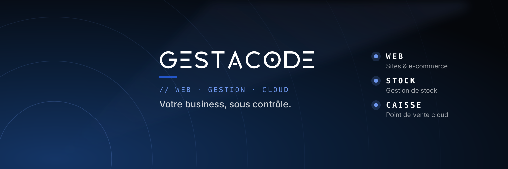

  

<h3 align="center">Votre business, sous contrôle.</h3>

Sites et boutiques en ligne <b>codés à la main</b>, reliés à votre <b>caisse</b> et à votre <b>stock</b>. 
Rapides sur mobile, bien placés sur Google, sécurisés. Agadir · Maroc & international.

---

### Ce qu'on fait

| | |
|---|---|
| 🛒 **Boutique sur mesure** | Un thème WooCommerce écrit pour votre catalogue. Un composant, un fichier, zéro page builder. |
| 🧩 **Extensions métier** | Ventes flash, packs à composer, suivi des prix concurrents, compteur de visites. |
| 🔗 **Liaisons** | Le site parle à la caisse, au transporteur et à WhatsApp. Une vente en ligne sort du stock du magasin. |
| ⚡ **Vitesse & SEO** | Mobile d'abord, Core Web Vitals au vert, travail de fond dans la Search Console. |

### Déjà en production

**[espacegamers.ma](https://espacegamers.ma)**: 740+ produits, 11 extensions écrites pour elle, PageSpeed mobile 87–90, stock lu dans la caisse toutes les heures.

### Méthode

`carte des dépendances` → `code court et clair` → `test sur téléphone d'abord` → `mise en ligne avec journal et sauvegarde`

### Stack

`PHP 8` · `JavaScript` · `MySQL` · `Python` · `WordPress` · `WooCommerce` · `Cloudflare` · `Hostinger`

---

<a href="https://www.instagram.com/gestacode">Instagram</a> ·
<a href="https://www.facebook.com/profile.php?id=61596831350488">Facebook</a> ·
<a href="https://www.youtube.com/@gestacode">YouTube</a> ·
<a href="https://x.com/Gestacode">X</a> ·
<a href="https://www.threads.com/@gestacode">Threads</a>

<code>// WEB · GESTION · CLOUD</code>

